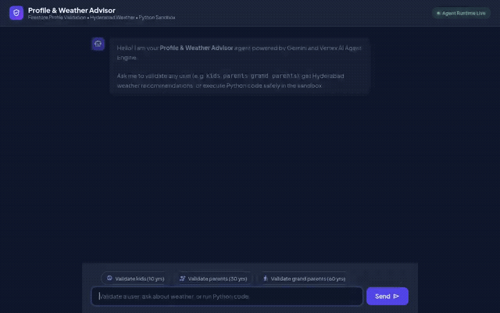

# 🌤️ Profile & Weather Advisor Agent

A multi-tool autonomous AI agent built with the **Google Agent Development Kit (ADK)** and deployed on **Google Cloud Vertex AI Agent Platform (Agent Runtime)**, paired with a modern chat and validation frontend deployed on **Cloud Run**.

The agent validates user profiles against a persistent structured Firestore database, retrieves real-time weather data for Hyderabad, provides age-tailored outdoor recommendations, and displays profile cartoon avatars and stylized database suggestions. It also includes sandboxed Python code execution via Agent Platform.

<div align="center">
  
</div>

---

## 🚀 What This Agent Actually Does

Based on the implemented codebase in `simple-agent/app/` and `frontend/`:

1. **User Profile Validation & Retrieval (Firestore)**:
   - Queries the `my-db` Firestore database (`my_details` collection) using hardcoded Google Cloud project configuration.
   - Accurately resolves registered profiles (`kids`, `parents`, `grand parents`).
   - Retrieves structured attributes including `name`, `age`, `suggestion`, `bg_color`, and `photo` avatar URL, while protecting private fields (like `govt_id` and `allow_social_media`).

2. **Real-time Hyderabad Weather & Age-Tailored Outdoor Activity**:
   - Fetches live weather conditions (temperature, humidity, sky condition) for Hyderabad, India via the Open-Meteo API.
   - Evaluates the user's age to recommend tailored outdoor activities:
     - **Kids (≤ 18 yrs)**: High-energy, child-safe activities (e.g. Sanjeevaiah Park cycling, kite flying, Jalavihar play area, Nehru Zoo).
     - **Young Adults (19–49 yrs)**: Fitness and adventure outings (e.g. Golconda Fort rampart trekking, Durgam Cheruvu cable bridge runs, Khajaguda Hills bouldering).
     - **Seniors (≥ 50 yrs)**: Low-impact, peaceful strolls (e.g. Lotus Pond evening walks, KBR National Park shaded trails, Qutb Shahi Tombs gardens).

3. **Media Storage & Profile Cartoon Avatars (Cloud Storage)**:
   - Profile cartoon images are hosted on a public Google Cloud Storage bucket (`gs://bwg3-qwiklabs-gcp-04-d5a16181d919/profile_photos/`).
   - Stored in the Firestore document `photo` column and automatically rendered as rich avatars in both the chat interface and the profile card.

4. **Dynamic Database Suggestion Styling**:
   - The database suggestion line dynamically applies the individual user's stored background color theme:
     - `kids`: **baby pink** (`#FBCFE8`)
     - `parents`: **light yellow** (`#FEF08A`)
     - `grand parents`: **light blue** (`#BAE6FD`)

5. **Clean & Uncluttered Output Formatting**:
   - Formats weather and activity recommendations into crisp bullet points (Location, Condition, Temperature, Humidity, Outdoor Activity).

6. **Secure Python Sandbox Execution**:
   - Integrated with `AgentEngineSandboxCodeExecutor` on Agent Platform to safely run dynamic Python calculations and data manipulations within an isolated sandbox environment.

7. **A2A (Agent-to-Agent) Protocol & Web Frontend**:
   - Built with a FastAPI proxy that communicates with the deployed Agent Engine via the official A2A protocol.
   - Features responsive chat dialogue, customizable example prompt chips, and Markdown card rendering.

---

## 🏗️ Architecture & Wired Google Cloud Services

| Layer | Service / Tool | Implementation Status |
| :--- | :--- | :--- |
| **Agent Core** | Google ADK (`LlmAgent` + `gemini-2.5-flash`) | **Wired & Deployed** |
| **Agent Runtime** | Vertex AI Reasoning Engine / Agent Engine | **Wired & Deployed** |
| **Structured DB** | Google Cloud Firestore (`my-db` / `my_details`) | **Wired & Active** |
| **Object Storage** | Google Cloud Storage (`profile_photos/` bucket) | **Wired & Active** |
| **Code Sandbox** | `AgentEngineSandboxCodeExecutor` | **Wired & Active** |
| **External Tools** | Open-Meteo REST API (Hyderabad Weather) | **Wired & Active** |
| **Protocol** | A2A Protocol (`attach_a2a_routes`) | **Wired & Active** |
| **Frontend** | FastAPI + Cloud Run container | **Wired & Deployed** |
| *Long-Term Memory Bank* | *Vertex AI Managed Memory Bank* | *Planned, not yet implemented* |

---

## 📂 Project Structure

```
.
├── simple-agent/
│   ├── app/
│   │   ├── agent.py            # ADK agent definition, tools, system instructions, sandbox executor
│   │   ├── fast_api_app.py     # FastAPI application with A2A routes and validation API
│   │   └── app_utils/          # A2A protocol handlers and services
│   ├── agents-cli-manifest.yaml# Agent Engine deployment manifest
│   ├── deployment_metadata.json# Agent Engine resource IDs and sandbox identifiers
│   ├── seed_firestore.py       # Firestore seeding and schema initialization script
│   └── requirements.txt        # Agent dependencies
├── frontend/
│   ├── main.py                 # FastAPI proxy connecting browser to agent via A2A
│   ├── static/
│   │   └── index.html          # Chat interface with styled avatars and suggestion chips
│   ├── Dockerfile              # Container definition for Cloud Run
│   └── requirements.txt        # Frontend proxy dependencies
└── README.md
```

---

## 🛠️ Local Setup & Run Instructions

### 1. Prerequisites
- Python 3.11+
- Google Cloud CLI (`gcloud`) authenticated to your Google Cloud project:
  ```bash
  gcloud auth login
  gcloud auth application-default login
  gcloud config set project YOUR_PROJECT_ID
  ```

### 2. Seed the Firestore Database
Ensure the `my-db` database is created in Firestore, then run:
```bash
python3 simple-agent/seed_firestore.py
```

### 3. Run the Agent Locally
You can test the agent locally using the ADK web runner:
```bash
cd simple-agent
adk web app
```
Or run the agent FastAPI application directly:
```bash
cd simple-agent
uvicorn app.fast_api_app:app --host 0.0.0.0 --port 8000
```

### 4. Run the Frontend Locally
Set your Agent Engine resource variables and start the frontend proxy server:
```bash
cd frontend
pip install -r requirements.txt

export AGENT_ENGINE_RESOURCE_NAME="projects/YOUR_PROJECT_NUMBER/locations/us-central1/reasoningEngines/YOUR_REASONING_ENGINE_ID"
export AGENT_DIRECTORY="app"

uvicorn main:app --host 0.0.0.0 --port 8080
```
Open your browser and navigate to the local host port serving the frontend application.

---

## 🚢 Deployment Instructions

### Deploy the Agent to Agent Platform
```bash
cd simple-agent
agents-cli deploy \
  --project=YOUR_PROJECT_ID \
  --region=us-central1 \
  --deployment-target=agent_runtime \
  --update-env-vars="SANDBOX_RESOURCE_NAME=YOUR_SANDBOX_RESOURCE_NAME"
```

### Deploy the Frontend to Cloud Run
```bash
cd frontend
gcloud run deploy frontend \
  --source . \
  --region us-central1 \
  --project YOUR_PROJECT_ID \
  --set-env-vars="AGENT_ENGINE_RESOURCE_NAME=YOUR_AGENT_ENGINE_RESOURCE_NAME,AGENT_DIRECTORY=app" \
  --allow-unauthenticated
```
